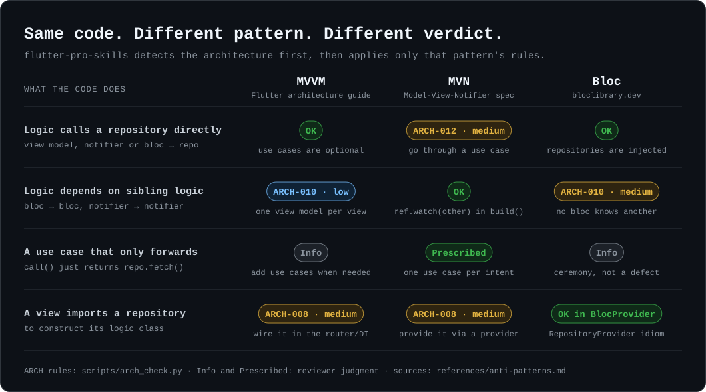
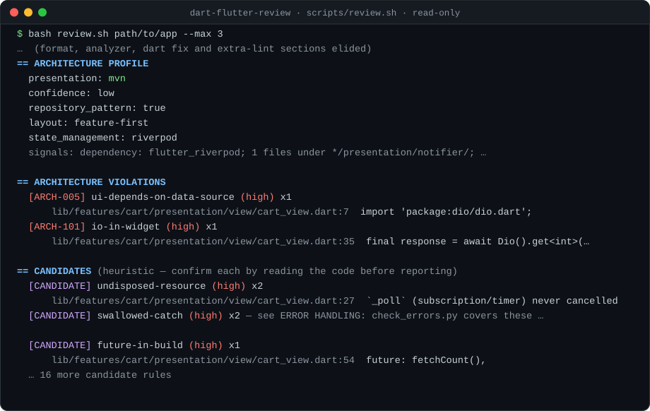

# flutter-pro-skills

**Agent Skills that make any AI coding agent write and review Flutter code
that is clean and secure by default, judged by your app's own architecture.**

> مهارات تخلّي أي AI agent يكتب ويراجع كود Flutter نضيف وآمن من الأول، وعلى نفس معمارية مشروعك. · [اقرأ بالعربي](README.ar.md)

[](https://github.com/abdelrahman-abied/flutter-pro-skills/actions/workflows/test.yml)
[](LICENSE)
[](https://agentskills.io)

<p align="center">
  
</p>

## Why this suite

- **Secure by default while writing, not after an audit.** In our benchmark,
  agents asked to "add login and store the token":
  - with the skills: both runs used `flutter_secure_storage`, with 0 security
    findings
  - without the skills: both runs stored the token in `SharedPreferences`
  - see [the benchmark](bench/README.md)
- **Judged by *your* architecture.** The suite detects MVVM, MVN, Bloc/Cubit,
  MVC, GetX, Provider, Riverpod and Clean Architecture, then applies only that
  pattern's rules. The patterns really do disagree: MVVM view models may call
  repositories, MVN notifiers go through use cases, and Bloc forbids
  bloc→bloc. Other packs pick one stack and flag everything else.
- **Real checkers, not just prose.**
  - Sixteen read-only checkers: architecture (import graph), error handling,
    test gaps, security defaults, navigation, forms, i18n/RTL, performance,
    persistence, networking, platform integration, design system, adaptive
    layout, accessibility, release (flavors, signing, store, CI), and review
    heuristics.
  - All of them use stdlib Python and have about 2,150 regression tests.
  - They are calibrated on real open-source apps: Flutter's Compass sample,
    the bloc and riverpod examples, lichess, immich, Wonderous, the drift
    examples and others.
- **A CI gate that fails PRs only on *new* violations,** so legacy code never
  blocks adoption.
- **Works with any agent that reads `SKILL.md`:** Claude Code, Codex, Cursor,
  GitHub Copilot, Gemini CLI, OpenCode and Antigravity. Verified on Claude
  Code and OpenCode.

## Quick start

```bash
npx skills add abdelrahman-abied/flutter-pro-skills     # open skills CLI, 70+ agents
```

Or use the installer, which writes to `~/.agents/skills` (Codex, Gemini CLI,
Copilot, Cursor, OpenCode, Antigravity) and `~/.claude/skills` (Claude Code):

```bash
git clone https://github.com/abdelrahman-abied/flutter-pro-skills
cd flutter-pro-skills && ./install.sh          # --project path/to/app · --link · --uninstall
```

Then just ask:
- *"Add a checkout feature."*
- *"Review my PR against main."*
- *"Is our structure right? We use Clean + MVN."*
- *"Store the auth token securely."*
- *"Find untested code."*
- *"Why does this list jank?"*
- *"Add dark mode with our design tokens."*
- *"Is this screen usable with TalkBack?"*
- *"Why does the spinner never stop?"*
- *"راجع الترجمة العربية والـ RTL."* ("Review the Arabic translation and the RTL.")

## The skills

| Skill | What it does | Checker |
|---|---|---|
| [`dart-flutter-best-practices`](skills/dart-flutter-best-practices/SKILL.md) | **Entry point.** Writing code: read the project, follow its conventions, verify with `dart format`/`dart analyze`. Effective Dart (149 guidelines mapped to lints), recommended lint set | — |
| [`flutter-architecture`](skills/flutter-architecture/SKILL.md) | Detects the pattern and judges by its rules. 28 automated rules and 28 documented anti-patterns | `arch_check.py` |
| [`flutter-feature-scaffold`](skills/flutter-feature-scaffold/SKILL.md) | New feature in **your** pattern (MVN, MVVM, Bloc, Cubit, GetX, Provider, Riverpod; ± Clean). **Secure by default**, compile-tested, never overwrites | `scaffold.py` |
| [`flutter-secure-defaults`](skills/flutter-secure-defaults/SKILL.md) | Security per layer: tokens in secure storage, auth in interceptors, HTTPS, no secrets in source, no PII in logs, safe WebViews | `check_secure_defaults.py` |
| [`flutter-error-handling`](skills/flutter-error-handling/SKILL.md) | Error flow through your architecture, `Result` vs exceptions, global handlers, no stuck spinners | `check_errors.py` |
| [`flutter-testing`](skills/flutter-testing/SKILL.md) | What to test first per architecture, test smells, untested units ranked | `test_gaps.py` |
| [`flutter-navigation`](skills/flutter-navigation/SKILL.md) | go_router, guards, deep-link validation, navigation placement per pattern | `check_navigation.py` |
| [`flutter-forms`](skills/flutter-forms/SKILL.md) | Validation, form state per pattern, password/OTP inputs, double-submit | `check_forms.py` |
| [`flutter-i18n`](skills/flutter-i18n/SKILL.md) | gen-l10n/ARB parity, Arabic plural forms, RTL layout and mirrored icons, formatting | `check_i18n.py` |
| [`flutter-performance`](skills/flutter-performance/SKILL.md) | Rebuild scope per pattern, `const`, `RepaintBoundary`, lazy lists and slivers, isolates, image decode size, jank diagnosis in DevTools | `check_performance.py` |
| [`flutter-persistence`](skills/flutter-persistence/SKILL.md) | Drift, sqflite, Hive, shared_preferences, caching, offline-first and sync, migrations, placed behind your repositories. Parameterised SQL only | `check_persistence.py` |
| [`flutter-networking`](skills/flutter-networking/SKILL.md) | The API client layer per architecture: one configured Dio/http client with timeouts, DTOs and validated JSON, pagination guards, cancellation, idempotent-only retry, WebSockets, fake clients in tests | `check_networking.py` |
| [`flutter-platform-integration`](skills/flutter-platform-integration/SKILL.md) | Native code as a data source: platform channels and Pigeon, FFI with freed memory, platform views, writing plugins, permissions at the moment of use, background isolates | `check_platform.py` |
| [`flutter-design-system`](skills/flutter-design-system/SKILL.md) | Tokens, `ThemeData`/`ColorScheme`, `ThemeExtension`, a component layer, dark mode, no raw colours or sizes in features | `check_design_system.py` |
| [`flutter-adaptive-layout`](skills/flutter-adaptive-layout/SKILL.md) | One codebase on phones, tablets, foldables, desktop and web: shared size classes, list-detail, bar vs rail, no orientation locks, hover and keyboard input, no `dart:io Platform` crashes on web | `check_adaptive.py` |
| [`flutter-accessibility`](skills/flutter-accessibility/SKILL.md) | `Semantics` and labels, tap targets, WCAG contrast, text scale, focus order, screen-reader tests. No secrets read aloud | `check_accessibility.py` |
| [`flutter-release`](skills/flutter-release/SKILL.md) | Shipping the app: flavors and environments injected at the root, signing kept out of git, versioning, store requirements, safe CI/CD (no secrets in logs, no `pull_request_target` holes) | `check_release.py` |
| [`flutter-ui-practices`](skills/flutter-ui-practices/SKILL.md) | Lifecycle and `dispose`, `context` after `await`, build cost, lists, keys | (review heuristics) |
| [`dart-naming`](skills/dart-naming/SKILL.md) | Effective Dart naming plus role names per architecture | — |
| [`dart-flutter-review`](skills/dart-flutter-review/SKILL.md) | **Review orchestrator.** Every checker, then parallel reviewer sub-agents, verified Highs, one deduplicated report, CI mode | `review.sh` |

For deep release audits (obfuscation, pinning, RASP, attestation), install the
companion skill [flutter-security-audit](https://github.com/abdelrahman-abied/flutter-security-audit).
The review runs its `scan.sh` automatically when it is installed.

### Which skill answers my question?

| You ask | Skill |
|---|---|
| "Create a new feature / screen / module" | `flutter-feature-scaffold` |
| "Is our architecture OK?", "where should this code go?" | `flutter-architecture` |
| "Store the token", "add login", "is this secure?" | `flutter-secure-defaults` |
| "Errors aren't shown", "app crashes", "Result or exceptions?" | `flutter-error-handling` |
| "What should I test?", "flaky tests" | `flutter-testing` |
| "go_router guards", "deep links" | `flutter-navigation` |
| "Validation", "login form", "double submit" | `flutter-forms` |
| "Translate", "Arabic", "RTL", "hardcoded strings" | `flutter-i18n` |
| "Memory leak", "setState after dispose" | `flutter-ui-practices` |
| "Jank", "slow list", "too many rebuilds", "compute / isolate" | `flutter-performance` |
| "Cache this offline", "Drift migration", "Hive or SQLite?" | `flutter-persistence` |
| "Set up Dio", "infinite scroll", "retry", "parse this JSON" | `flutter-networking` |
| "Add flavors", "sign the release", "publish to the Play Store", "release workflow" | `flutter-release` |
| "Call native code", "MethodChannel", "Pigeon", "FFI", "write a plugin", "ask for permission" | `flutter-platform-integration` |
| "Dark mode", "design tokens", "ThemeExtension", "hard-coded colours" | `flutter-design-system` |
| "Tablet layout", "make it responsive", "desktop/web support", "breakpoints" | `flutter-adaptive-layout` |
| "Screen reader", "TalkBack/VoiceOver", "contrast", "tap target" | `flutter-accessibility` |
| "What should I call this?" | `dart-naming` |
| "Review my PR / codebase" | `dart-flutter-review` |
| "Write / refactor this", "set up lints" | `dart-flutter-best-practices` |

Agents pick the right skill from its description. To force one:

| Agent | How to force a skill |
|---|---|
| Claude Code, Cursor | `/dart-flutter-review` |
| Codex | `$dart-flutter-review` |
| Gemini CLI, Copilot, OpenCode | name it: *"use the dart-flutter-review skill"* |

---

## See it work

<p align="center">
  
</p>

```bash
bash ~/.agents/skills/dart-flutter-review/scripts/review.sh path/to/app [--diff main]   # everything, read-only
python3 ~/.agents/skills/flutter-architecture/scripts/arch_check.py path/to/app [--json]
python3 ~/.agents/skills/flutter-secure-defaults/scripts/check_secure_defaults.py path/to/app
python3 ~/.agents/skills/flutter-accessibility/scripts/check_accessibility.py path/to/app
python3 ~/.agents/skills/flutter-feature-scaffold/scripts/scaffold.py path/to/app orders    # dry run
```

See a full report at [docs/examples/sample-review.md](docs/examples/sample-review.md),
and raw outputs in [docs/examples/](docs/examples/).

## CI: fail pull requests on new violations only

```yaml
# .github/workflows/flutter-review.yml
on: pull_request
jobs:
  review:
    runs-on: ubuntu-latest
    steps:
      - uses: actions/checkout@v4
        with: { fetch-depth: 0 }
      - uses: abdelrahman-abied/flutter-pro-skills@v1
        with:
          base-ref: origin/${{ github.base_ref }}
          fail-on: high
          baseline: .github/arch-baseline.json   # optional: record today's issues once, fail only on new ones
          flutter: true                          # also run the analyzer and every checker
```

Create the baseline once with
`python3 …/arch_check.py . --write-baseline .github/arch-baseline.json`.
See [`ci.md`](skills/dart-flutter-review/references/ci.md) for the details.

## Benchmark

We ran the same 3 tasks with and without the skills on a free, non-Claude
model (OpenCode + big-pickle, 2 runs each):

| Task | Without skills | With skills |
|---|---|---|
| **Write**: add login and store the token | Token in `SharedPreferences` (1 high security finding, both runs) | `flutter_secure_storage`, **0 security findings** (both runs) |
| **Review**: 12 planted issues | 92% recall, 0.5 MVN decoys flagged | 96% recall, **0** decoys flagged, more extra findings, about 6× slower |
| **Bloc architecture**: 2 planted violations | 2/2 | 2/2, with 1.5 claims contradicting bloclibrary (a calibration bug, **fixed** since) |

Small N, author-written fixtures, one model. See the full method, the
limitations and how to re-run it in [bench/README.md](bench/README.md).

## Works alongside the official skills

The Flutter and Dart teams publish
[flutter/agent-plugins](https://github.com/flutter/agent-plugins) and
[dart-lang/skills](https://github.com/dart-lang/skills). **Install them too.**
They are step-by-step recipes. This suite adds architecture-aware judgment,
secure-by-default writing, checkers and a review/CI pipeline. Where an official
recipe exists, these skills point to it.

## Make every agent on a team follow it

1. **Declare your architecture** in `AGENTS.md`, using
   [`AGENTS-snippet.md`](skills/dart-flutter-best-practices/assets/AGENTS-snippet.md).
2. **Adopt the lint set**
   [`analysis_options.yaml`](skills/dart-flutter-best-practices/assets/analysis_options.yaml).
3. **Enforce formatting** with
   [`format-dart-hook.sh`](skills/dart-flutter-best-practices/scripts/format-dart-hook.sh),
   as an agent hook or a git pre-commit hook.
4. **Gate PRs** with the GitHub Action above.

To accept a specific finding, add `// arch-ignore: ARCH-005 <reason>` on that
line or the line above it. There are matching `err-`, `sec-`, `nav-`, `form-`,
`i18n-`, `perf-`, `persist-`, `net-`, `ds-`, `a11y-`, `rel-`, `plat-` and `adapt-ignore` comments.

**Precedence:**
1. Your project's own decisions: lints, the declared architecture, and
   conventions used consistently.
2. The pattern's canonical source.
3. Effective Dart.
4. Flutter team guidance.

**Agents without skills support:** point your `AGENTS.md`, `CLAUDE.md`,
`GEMINI.md` or `.cursor/rules` at
`…/skills/dart-flutter-best-practices/SKILL.md` and
`…/skills/dart-flutter-review/SKILL.md`.

**Requirements:**
- `bash` and `python3` 3.8 or later (stdlib only).
- The Dart/Flutter SDK, for the analyzer passes. Without it they're skipped,
  not failed.
- On Windows, use Git Bash or WSL.

---

## Contributing

False-positive reports are the most valuable contribution. Use the
[false-positive issue form](.github/ISSUE_TEMPLATE/false_positive.yml), and
see [CONTRIBUTING.md](CONTRIBUTING.md) and [`docs/CONTRACTS.md`](docs/CONTRACTS.md).

```bash
bash tests/run_all.sh     # spec + YAML validation and every skill's tests; no Flutter SDK needed
```

## License

MIT, © 2026 Abdulrahman Obaid. Parts summarise or adapt the Dart/Flutter docs
(CC BY) and the Bloc/Riverpod docs (MIT); see [`NOTICE.md`](NOTICE.md). MVN
(Model-View-Notifier) is by Abdulrahman Abied. Changes are listed in
[`CHANGELOG.md`](CHANGELOG.md).
